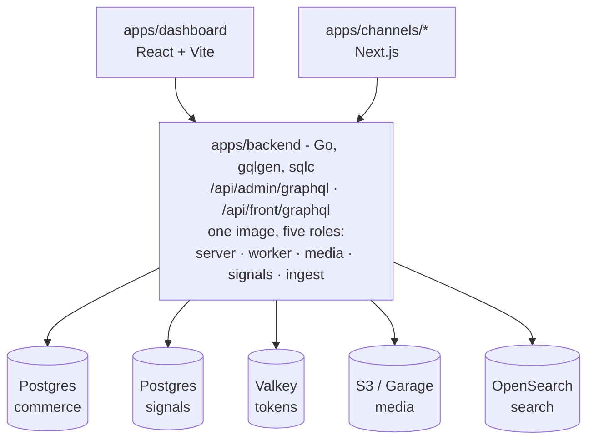

<p align="center">
  
</p>

<p align="center">
  <b>A self-hosted ecommerce platform.</b><br>
  Go GraphQL backend · React admin · Next.js storefronts · everything in containers
</p>

<p align="center">
  <a href="https://github.com/skeletg/skelet/actions/workflows/ci.yml"></a>
  
  
  <a href="LICENSE"></a>
</p>

---

Multi-store and multi-locale from day one: one backend runs several storefronts in
different currencies, languages and brand identities, sharing one product catalog
where that makes sense and diverging where it doesn't. A clone is a working shop.

Catalog, carts, orders, customers, inventory, promotions, tax, subscriptions, gift
cards, loyalty, B2B, a blog and a block-based CMS. Plus **Signals**, a built-in
analytics stack with four surfaces - Lens for web, Synapse for customers, Pulse for
email, Prism for experiments - writing to its own database.

Underneath: per-channel role permissions, a runtime config registry, machine-to-machine
integration tokens, HMAC-signed webhooks, a transactional outbox for durable async work,
and a scheduled-jobs engine with retries and alerting.

## Quickstart

You need Docker. Nothing else - the frontend toolchain runs in containers too.

```bash
git clone git@github.com:skeletg/skelet.git
cd skelet
./skelet setup                       # picks apps, writes env, starts containers, migrates
./skelet up                          # backend + your selected apps + sidecars
./skelet cli admin create-superuser  # your first login
```

Open <http://localhost:5173> and sign in. GraphQL playgrounds are at
`:8080/playground/{admin,front}`.

`./skelet` is the front door - run it bare to list every command, `./skelet help <command>`
to explain one. Every verb is still a script in `bin/`, unchanged and callable directly.

## Architecture



**Two GraphQL endpoints, one backend.** Admin and storefront share a process but have
entirely separate schemas, generated executables and resolver trees - storefront
introspection cannot see admin operations.

**Multi-channel from the ground up.** Catalog data is global; per-channel availability is
a listing row. A category can be live on the US channel and hidden on the EU one with one
toggle.

**Schemas are the contract.** gqlgen generates resolvers from `.graphqls`, sqlc generates
the data layer from `.sql` (there are no hand-written DB calls), graphql-codegen generates
the frontends' types. `./skelet gen` runs all of it, and `./skelet check codegen` fails when
the committed output has drifted from its source.

## Documentation

Everything lives in `docs/`, one file per question - **[start with the index](docs/README.md)**,
or go straight to [concepts.md](docs/concepts.md) for the vocabulary the rest assumes.

## License

[GPL-3.0](LICENSE), with the [Skelet Plugin Exception](PLUGIN-EXCEPTION.txt).

Run it, modify it, host it, build client sites on it, sell services around it - none of
that asks anything of you. Convey Skelet *itself* and whoever receives it gets the source
under the same licence, so a fork can't go closed. **Plugins, remote providers, storefronts,
dashboard extensions and themes are exempt** and stay yours under any licence you like.

The Skelet name and logo are separate from the code licence and are not granted by it.
