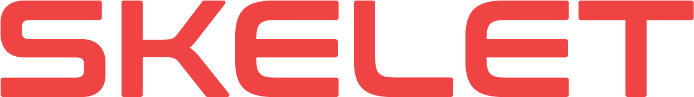
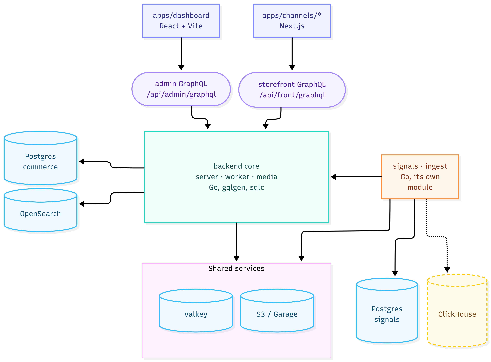

<p align="center">
  
</p>

<p align="center">
  <b>A self-hosted ecommerce platform.</b><br>
  Go GraphQL backend · React admin · Next.js storefronts · everything in containers
</p>

<p align="center">
  <a href="https://github.com/skeletg/skelet/actions/workflows/ci.yml"></a>
  
  
  <a href="LICENSE"></a>
</p>

---

Multi-store and multi-locale from day one: one backend runs several storefronts in
different currencies, languages and brand identities, sharing one product catalog
where that makes sense and diverging where it doesn't. A clone is a working shop.

Catalog, carts, orders, customers, inventory, promotions, tax, subscriptions, gift
cards, loyalty, a blog and a block-based CMS. Plus **Signals**, a built-in
analytics stack with four surfaces - Lens for web, Synapse for customers, Pulse for
email, Prism for experiments - writing to its own database.

The rest is plugins: Go compiled into the binary, added with `skelet cli plugin add`,
each one its own versioned module - payment gateways, whole business domains with their own
tables and admin screens, or a small integration. See [docs/plugins.md](docs/plugins.md).

Underneath: per-channel role permissions, a runtime config registry, machine-to-machine
integration tokens, HMAC-signed webhooks, a transactional outbox for durable async work,
and a scheduled-jobs engine with retries and alerting.

## Quickstart

You need Docker and git. Nothing else - the frontend toolchain runs in containers too.

```bash
curl -fsSL https://github.com/skeletg/skelet/releases/latest/download/install.sh | sh
skelet new my-shop                 # fetches the latest release, picks apps, offers your storefront, writes env, starts containers
cd my-shop
skelet up                          # backend + your selected apps + sidecars
skelet cli admin create-superuser  # your first login
```

Your storefront is a copy of a template under `templates/` - `nextjs-vetrina` (Next.js) or `astro-shop`
(Astro) - that's yours to change. Setup offers one when the project has none; `skelet new my-shop
--template astro-shop` makes it without asking, and `skelet add channel <name>` makes more later.

The installer checks `skelet` against the release's checksums and puts it in `~/.local/bin`
(`SKELET_INSTALL_DIR` picks another directory); it runs on macOS, Linux and WSL. Rather clone
by hand? `git clone https://github.com/skeletg/skelet.git`, then `skelet setup` inside it - in a
project, `skelet` runs that project's own code. With Go and nothing installed,
`go -C cmd/skelet run . setup` does the same.

Open <http://localhost:5173> and sign in. GraphQL playgrounds are at
`:8080/playground/{admin,front}`.

`skelet` is the front door - run it bare to list every command, `skelet help <command>`
to explain one. The scripts under `bin/` are what it runs.

## Architecture



**Signals is optional.** `SIGNALS_ENABLED=false` runs the commerce process alone: no suite
containers, no gRPC client, and the dashboard hides the suite's screens. When it is on, core
never opens the signals database - everything crosses the gRPC contract, and the suite reads
core back through the storefront API with a service token. The suite shares Valkey and object
storage with core, keeps its event spine in ClickHouse, and can put NATS JetStream in front of
ingestion.

**Two GraphQL endpoints, one backend.** Admin and storefront share a process but have
entirely separate schemas, generated executables and resolver trees - storefront
introspection cannot see admin operations.

**Multi-channel from the ground up.** Catalog data is global; per-channel availability is
a listing row. A category can be live on the US channel and hidden on the EU one with one
toggle.

**Schemas are the contract.** gqlgen generates resolvers from `.graphqls`, sqlc generates
the data layer from `.sql` (there are no hand-written DB calls), graphql-codegen generates
the frontends' types. `skelet gen` runs all of it, and `skelet check codegen` fails when
the committed output has drifted from its source.

## Documentation

Everything lives in `docs/`, one file per question - **[start with the index](docs/README.md)**,
or go straight to [concepts.md](docs/concepts.md) for the vocabulary the rest assumes.

## Contributing

We're not accepting pull requests yet, but bug reports and ideas are very welcome as
issues - [CONTRIBUTING.md](CONTRIBUTING.md) has the details. Found a security problem?
Please report it privately, as [SECURITY.md](SECURITY.md) describes, rather than in a
public issue.

## License

[GPL-3.0](LICENSE), with the [Skelet Plugin Exception](PLUGIN-EXCEPTION.txt).

Run it, modify it, host it, build client sites on it, sell services around it - none of
that asks anything of you. Convey Skelet *itself* and whoever receives it gets the source
under the same licence, so a fork can't go closed. **Plugins, remote providers, storefronts,
dashboard extensions and themes are exempt** and stay yours under any licence you like.

The Skelet name and logo are separate from the code licence and are not granted by it.
